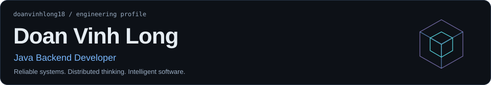
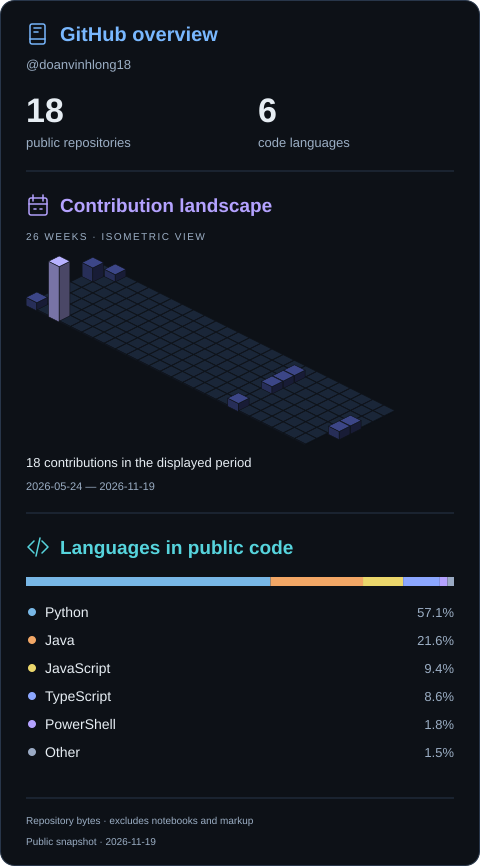
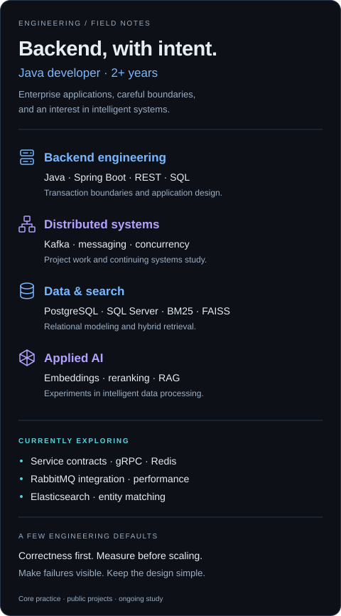

<picture>
  <source media="(max-width: 600px)" srcset="assets/profile-header-mobile.svg">
  
</picture>

I'm **Doan Vinh Long**, a Java Backend Developer with **2+ years of professional experience** developing enterprise business applications.

My work centers on backend systems. My public projects and ongoing study extend into distributed architectures, concurrency, performance, and AI-powered search.

<picture>
  
</picture>
<picture>
  
</picture>

Languages describe public repository contents, not professional proficiency. Notebook and markup bytes are excluded. Contribution activity is context, not a skill ranking.

### Around the workbench

<a href="https://github.com/doanvinhlong18/ShopCore">ShopCore</a> &nbsp; · &nbsp; <a href="https://github.com/doanvinhlong18/RAG-NEWS">RAG-NEWS</a> &nbsp; · &nbsp; <a href="https://github.com/doanvinhlong18/RecommenderSystem">RecommenderSystem</a> &nbsp; · &nbsp; <a href="https://github.com/doanvinhlong18/BigData">BigData</a>

  
More about my engineering work

My professional background is Java and enterprise business applications. The public repositories linked above are learning and research work, separate from my employment.

- **Backend:** Java, Spring Boot, Spring Data JPA / Hibernate, REST APIs, SQL, and transactional processing.
- **Distributed systems:** Kafka and asynchronous processing in project work; service boundaries and concurrency in continuing study.
- **Data & search:** PostgreSQL, SQL Server, BM25, FAISS, and hybrid retrieval.
- **Applied AI:** semantic embeddings, reranking, RAG, and recommendation. Entity matching is an ongoing research interest.
- **Infrastructure & engineering:** Docker, Git, Prometheus, Grafana, Spring Boot Actuator, and regression tests in public projects.
- **Building foundations:** gRPC / Protobuf contracts, Redis, RabbitMQ integration, Elasticsearch, additional Micrometer instrumentation, and performance analysis.

ShopCore implements identity and refresh-token rotation; its other business flows remain scaffolded. RAG-NEWS explores news retrieval and generation. RecommenderSystem combines content and collaborative recommendation. BigData processes replayed taxi events through a streaming and ML pipeline. These are project descriptions, not claims of commercial deployment.

My engineering defaults: correctness before optimization, measurement before scaling, explicit failure handling, useful observability, and simple designs.

---

[**github.com/doanvinhlong18 ↗**](https://github.com/doanvinhlong18)

Infographic layout inspired by [lowlighter](https://github.com/lowlighter) and [lowlighter/metrics](https://github.com/lowlighter/metrics).
