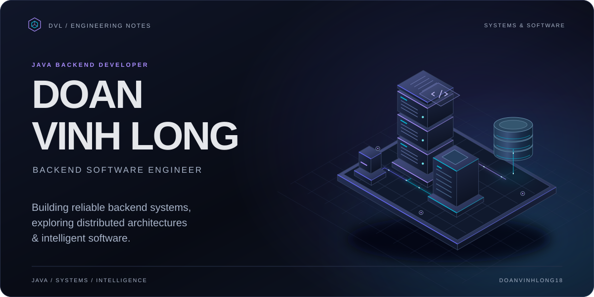
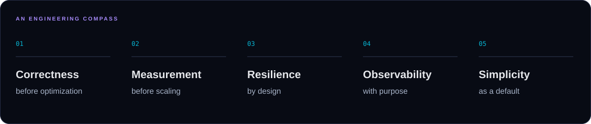
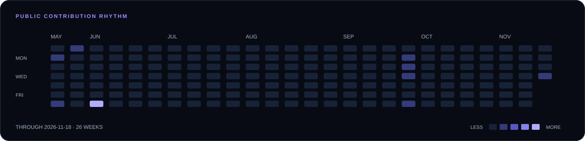

<picture>
  <source media="(max-width: 600px)" srcset="assets/hero-mobile.svg">
  
</picture>

  <a href="#about">About</a> &nbsp; / &nbsp;
  <a href="#engineering-focus">Engineering focus</a> &nbsp; / &nbsp;
  <a href="#technical-arsenal">Stack</a> &nbsp; / &nbsp;
  <a href="#project-notes">Projects</a> &nbsp; / &nbsp;
  <a href="#connect">Connect</a>

## About

I'm **Doan Vinh Long**, a **Java Backend Developer with 2+ years of professional experience** developing enterprise business applications.

I care about how backend systems behave beyond the happy path: transaction boundaries, concurrent workloads, failure handling, and the cost of each design decision. My current interests include scalable architecture, distributed systems, concurrency, and performance.

Alongside my backend work, I explore **AI-powered search, entity matching, and intelligent data processing** through public projects and independent study.

## Engineering focus

My professional foundation is Java and enterprise application development. Distributed systems, search, and AI extend that foundation through project work and ongoing research.

<table>
  <tr>
    <td width="50%" valign="top">
      
      <h3>Backend Engineering</h3>
      
Java, Spring Boot, REST APIs, SQL, and transactional processing.

      
CORE PRACTICE · APPLICATION DESIGN

    </td>
    <td width="50%" valign="top">
      
      <h3>Distributed Systems</h3>
      
Kafka, messaging, asynchronous processing, Redis, and concurrency.

      
PROJECT WORK · CONTINUING STUDY

    </td>
  </tr>
  <tr>
    <td width="50%" valign="top">
      
      <h3>Data &amp; Search</h3>
      
Relational data, PostgreSQL, SQL Server, sparse and dense retrieval.

      
PROJECT WORK · SEARCH RESEARCH

    </td>
    <td width="50%" valign="top">
      
      <h3>AI Engineering</h3>
      
Semantic search, embeddings, reranking, RAG, and entity matching.

      
PUBLIC EXPERIMENTS · ONGOING RESEARCH

    </td>
  </tr>
</table>

## Technical arsenal

A working toolkit, with a clear distinction between implemented project work and areas I'm investigating.

| Area | Used in public projects |
| :--- | :--- |
| **Languages** | Java · SQL · Python |
| **Backend** | Spring Boot · Spring Data JPA / Hibernate · REST · FastAPI |
| **Databases & search** | PostgreSQL · SQL Server · FAISS · BM25 |
| **Messaging & infrastructure** | Kafka · Spark Structured Streaming · Docker · Git |
| **Observability & engineering** | Prometheus · Grafana · Spring Boot Actuator · regression tests |

**Exploring / building foundations:** gRPC contracts, Redis, RabbitMQ integration, Elasticsearch, Micrometer instrumentation, concurrency, and performance analysis.

gRPC contracts, Redis, and RabbitMQ are configured in ShopCore; their business flows are still in progress. Elasticsearch and entity matching are research interests. This is a map of my work and learning, not a proficiency ranking.

## Project notes

Small windows into what I'm building and studying. These are public learning and research projects, separate from my professional work.

| Project | Problem, approach & engineering questions |
| :--- | :--- |
| [**ShopCore ↗**](https://github.com/doanvinhlong18/ShopCore) | A Java / Spring Boot microservices learning environment. PostgreSQL-backed identity, RS256 JWTs, and refresh-token rotation are implemented; other flows are scaffolded. **Focus:** transaction boundaries, token reuse, and service ownership. |
| [**RAG-NEWS ↗**](https://github.com/doanvinhlong18/RAG-NEWS) | News question answering with Python, BM25 + FAISS, rank fusion, encoder reranking, and LLM generation. **Focus:** retrieval quality, sparse-index memory use, and context selection. |
| [**RecommenderSystem ↗**](https://github.com/doanvinhlong18/RecommenderSystem) | Anime recommendations combining semantic content, collaborative filtering, implicit ALS, and FastAPI. **Focus:** cold starts, score normalization, and ranking diversity. |
| [**BigData ↗**](https://github.com/doanvinhlong18/BigData) | NYC taxi event replay through Kafka, Spark, Delta Lake / MinIO, and LightGBM; PostgreSQL serving with Prometheus / Grafana. **Focus:** late events, exact-time features, model fallback, and streaming telemetry. |

## How I approach engineering

<picture>
  <source media="(max-width: 600px)" srcset="assets/principles-mobile.svg">
  
</picture>

- **Correctness before optimization.** Make invariants and transaction boundaries explicit.
- **Measure before scaling.** Use evidence to find the bottleneck.
- **Design for failure.** Consider retries, partial failure, and recovery paths.
- **Make behavior observable.** Give logs, metrics, and tests a clear purpose.
- **Keep the design simple.** Add complexity when the problem calls for it.

## GitHub activity

<picture>
  <source media="(max-width: 600px)" srcset="assets/activity-mobile.svg">
  
</picture>

Public contribution intensity · dated snapshot · [live activity on GitHub](https://github.com/doanvinhlong18?tab=overview). Activity is context, not a measure of skill.

## Connect

For repositories and public engineering work, find me at [**github.com/doanvinhlong18 ↗**](https://github.com/doanvinhlong18).

<picture>
  <source media="(max-width: 600px)" srcset="assets/signature-mobile.svg">
  
</picture>
